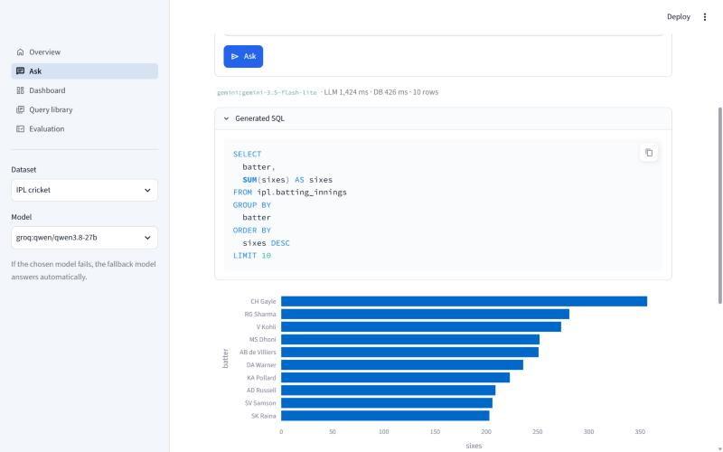
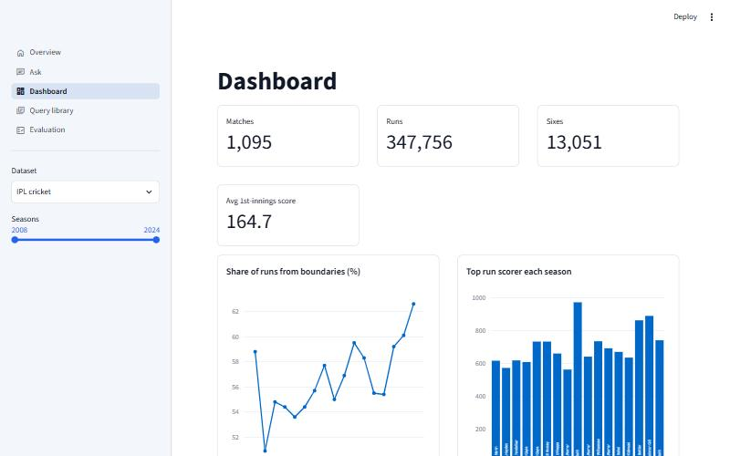
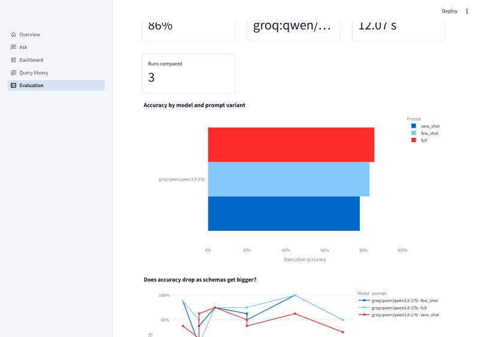
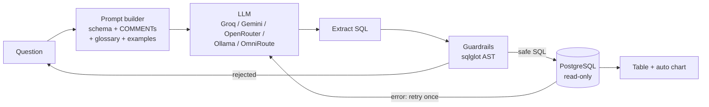

# Ask Your Data — AI Text-to-SQL Analytics Assistant

Ask a question in plain English about one of 8 real datasets and get back the SQL, a results table
and a chart. An LLM writes the SQL from the database's own schema and data dictionary; AST-based
guardrails check it; a read-only PostgreSQL connection runs it.

**Benchmark:** 86% execution accuracy on 160 questions ([details](#benchmark)) · **Runs locally**
([setup](#run-it-locally-windows--powershell)) · **Built with:** Python · PostgreSQL · SQLAlchemy · pandas ·
Streamlit · Plotly · sqlglot · OpenAI-compatible LLM APIs · pytest



| Dashboard | Evaluation |
|---|---|
|  |  |

In the Ask screenshot, qwen was selected but rate-limited, so the fallback model answered; the
footer shows which model actually answered.

---

## What it does

| Page | What you get |
|---|---|
| **Ask** | Type a question → generated SQL (shown), result table, auto-chosen chart, model name and LLM / DB time |
| **Dashboard** | 4 KPI tiles + 4 charts per dataset, with season / year / month filters |
| **Query library** | 72 hand-written, commented SQL queries (CTEs, window functions, recursive CTEs, cohorts) |
| **Evaluation** | Execution accuracy of 3 prompt styles on a 160-question benchmark, per dataset |

## The 8 datasets (1 table → 11 tables)

| Dataset | Tables | Rows (main table) | Why it is in the benchmark |
|---|---|---|---|
| Campus placements | 1 | 215 students | single-table baseline |
| Indian startup funding | 2 | 3,044 rounds | very dirty source data |
| IPL cricket 2008–2024 | 2 + 2 views | 260,920 deliveries | domain metrics (strike rate, economy) |
| Air quality in India | 3 | 29,531 city-days | time series, seasons, the 2020 lockdown |
| Netflix titles | 5 | 8,807 titles | many-to-many bridge tables |
| E-commerce (Amazon India seller) | 5 | 128,975 order lines | business metrics (revenue, AOV, cancellations) |
| Olist marketplace (Brazil) | 8 | 99,441 orders | many joins, the `customer_unique_id` trap |
| Chinook music store | 11 | 412 invoices | classic Text-to-SQL test database, hierarchies |

Sources, licences and every cleaning decision: [docs/DATA_SOURCES.md](docs/DATA_SOURCES.md).

## How it works



- **The prompt is built from the database itself**: table and column `COMMENT`s, plus an optional
  per-dataset metric glossary and few-shot examples (`knowledge/<dataset>/`). Nothing in `src/` names a
  table or column — the engine is dataset-agnostic and takes the SQL dialect as a parameter.
- **Safety in layers**: the SQL is parsed into a syntax tree and must be exactly one `SELECT` on the
  chosen schema, with no write statements anywhere in the tree and no dangerous functions; a `LIMIT` is
  added. The SQL that runs is re-rendered from the validated tree. It runs in a `READ ONLY` transaction
  with a 10 s timeout and a 1,000-row cap; the deployed app connects as a database role that can only
  `SELECT` ([scripts/create_readonly_role.sql](scripts/create_readonly_role.sql)).
- **Self-correction**: if the database returns an error, the error goes back to the model once.
- **Provider-agnostic**: every provider speaks the OpenAI chat API, so models are configured as
  `provider:model_id` in `.env`, with automatic fallback to a second model.

## Benchmark

160 questions — 20 per dataset (6 easy, 9 medium, 5 hard) — each with hand-written gold SQL.
An answer is correct when its **result rows** match the gold result (*execution accuracy*), not the SQL text.

How the scoring was made fair, and how that is checked:
- numbers compared at the precision the gold answer uses (12.4637 matches 12.5; 12.4 does not);
- row order only required when the question asks for it; "Which X …?" questions require only X;
- `python -m eval.sanity_check`: a perfect model must score **160/160** and a negative control
  (each question answered with another question's SQL) **0/160** — both hold on the real data.

**Results** — one model, `qwen/qwen3.8-27b` via Groq, with 3 prompt styles:

| Prompt | What the prompt contains | Correct | Accuracy | Median latency |
|---|---|---|---|---|
| zero_shot | schema + `COMMENT`s | 125 / 160 | 78% | 4.9 s |
| few_shot | + example question/SQL pairs | 133 / 160 | 83% | 9.9 s |
| full | + examples + metric glossary | 137 / 160 | **86%** | 12.1 s |

| Dataset (tables) | placements (1) | ipl (2) | startups (2) | air_quality (3) | ecommerce (5) | netflix (5) | olist (8) | chinook (11) |
|---|---|---|---|---|---|---|---|---|
| zero_shot | 75% | 65% | 85% | 90% | 75% | 80% | 85% | 70% |
| full | 95% | 80% | 60% | 90% | 90% | 90% | 100% | 80% |

What the numbers show:
- **More context helps (+8 points)** but costs latency: the full prompt is ~2.5× slower than schema only.
- **No clear drop as the schema grows**: the 8-table Olist dataset scored highest. The domain wording
  With 20 questions per dataset, the differences between datasets are within noise.
- **Startups got worse with context (85% → 60%)**. The examples and glossary teach "show amounts in
  millions" and "ignore *Undisclosed Investors* placeholders"; the gold answers use raw dollars and keep
  the placeholders. The SQL logic was right but the values differ, so execution accuracy marks it
  wrong. Lesson: the prompt's conventions and the benchmark's conventions must agree.
- In the full run, 159/160 answers were valid SQL; 1 was blocked by the guardrails and 1 needed the
  self-correction retry.

Free-tier limits: Groq allows a fixed number of tokens per day, so the runner saves after every
question and resumes where it stopped (the full run was spread over several days of quota).

## Engineering

- **863 tests** (`pytest`): cleaning rules on deliberately messy fixture data, every analysis query and
  gold query, guardrails (incl. injection attempts), the scorer, and every app page rendered with
  Streamlit's `AppTest`. LLM calls are always mocked.
- **CI**: GitHub Actions with a PostgreSQL 16 service container runs `ruff` and the full test suite.
- **Reproducible**: loaders are idempotent (one transaction per dataset); fixtures are small samples of
  the real files that always include the hard cases.
- **Learning notes**: [docs/LEARNING_NOTES.md](docs/LEARNING_NOTES.md) explains every phase and concept;
  [docs/INTERVIEW_GUIDE.md](docs/INTERVIEW_GUIDE.md) is the one-page version.

## Run it locally (Windows / PowerShell)

Needs Python 3.11+ and PostgreSQL 16.

```powershell
python -m venv .venv
.venv\Scripts\activate
pip install -r requirements.txt
copy .env.example .env          # then fill in DATABASE_URL and one LLM key
python -m scripts.check_setup   # connects and creates the 8 schemas
python -m scripts.load_all      # loads the datasets (download them first - see docs/DATA_SOURCES.md)
streamlit run app/Home.py
```

Tests: create an empty database, set `TEST_DATABASE_URL` in `.env`, then `pytest`.
Benchmark: `python -m eval.run_all` (resumes where it stopped), then `python -m eval.summarize`.

## Project structure

```
app/        Streamlit app (Home.py + app_pages/)
src/        engine: config, db, guardrails, LLM client + providers, prompts, text_to_sql, charts
scripts/    one loader per dataset, setup check, read-only role
sql/        schema files (DDL + COMMENT ON) and 72 analysis queries
knowledge/  per-dataset glossary and few-shot examples
eval/       160 questions, scorer, runner, summary
tests/      pytest suite + small fixture datasets
docs/       data sources, learning notes
```
