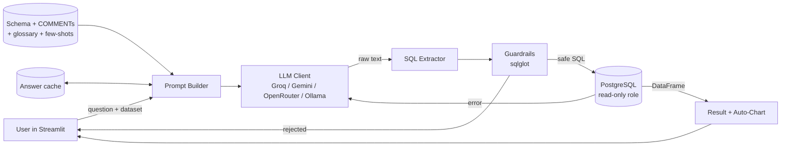
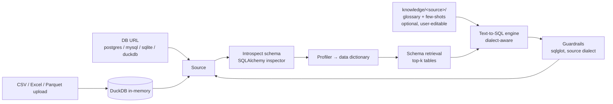

# Ask Your Data — Project Specification (SRS + Build Roadmap)

> **Single source of truth for this project.** Claude Code: read this whole file before writing code,
> build it **phase by phase** (Section 14), and tick the checkboxes as each item is done.

---

## 1. Overview

**Ask Your Data** is an AI-powered analytics assistant. A user picks a dataset, types a question in plain
English (e.g. *"Top 5 batters by strike rate in death overs since 2020"*), and the app:

1. converts the question to PostgreSQL using an LLM,
2. validates the SQL with safety guardrails,
3. runs it on a read-only database,
4. shows the SQL, a results table, and an auto-chosen chart.

It also has hand-built analytics dashboards and a **measured accuracy benchmark** comparing LLMs and
prompting strategies across **8 datasets of increasing difficulty** (1 table → 11 tables).

### 1.0 The 8 datasets (all downloaded into `data/raw/`)

| # | Schema | Domain | Tables after load | Difficulty for Text-to-SQL | Why it's in the benchmark |
|---|---|---|---|---|---|
| 1 | `placements` | Education (India) | 1 | Easy | Single table baseline |
| 2 | `netflix` | Media | 5 (titles + 4 bridge tables) | Medium | Splitting comma lists → many-to-many joins |
| 3 | `startups` | Finance (India) | 2 | Medium | Very dirty data (dates, amounts, names) |
| 4 | `air_quality` | Environment (India) | 3 | Medium | Time series, dates, seasonal/YoY questions |
| 5 | `ecommerce` | Retail (India, Amazon seller) | 5 | Medium | Business metrics (revenue, AOV, cancellations) |
| 6 | `ipl` | Sports (India) | 2 + 2 views | Hard | Domain metrics (strike rate, economy) need a glossary |
| 7 | `olist` | Marketplace (Brazil) | 8 | Hard | Many joins, timestamps, "customer_id vs customer_unique_id" trap |
| 8 | `chinook` | Music store (classic benchmark) | 11 | Hard | Standard Text-to-SQL test DB, self-joins / hierarchy |

This spread lets the README report findings like *"accuracy drops from X% on single-table data to Y% on
11-table data, and the glossary recovers Z points"* — a real, interview-worthy result.

### 1.0b Important: the 8 datasets are a benchmark, not training data
No model is trained or fine-tuned. The LLM reads the database **schema at runtime**, so the same engine
works on any database. The 8 datasets exist to (a) demo the app and (b) **measure** how well the engine
generalises across very different schemas. Other developers must be able to point the engine at **their
own database or files** (Section 17).

### 1.1 Why this project exists (portfolio goals)
The owner is a B.Tech CS student targeting **Software, AI, and AI Data Analytics** roles. The project must
visibly prove:

| Skill | Evidence in this repo |
|---|---|
| SQL (joins, CTEs, window functions) | `sql/analysis/**` — 72 hand-written, commented queries over 8 datasets |
| Data cleaning / modelling (pandas) | `scripts/load_*.py`, schema design, data dictionary |
| Visualization / dashboards | Streamlit dashboard pages with KPIs + Plotly charts |
| LLM engineering | Text-to-SQL engine, prompt design, few-shot, self-correction |
| Evaluation mindset | 160-question benchmark over 8 datasets, accuracy + latency per model, results table in README |
| Software engineering | Modular code, guardrails, tests, CI, Docker-free reproducible setup, deployment |

### 1.2 Out of scope
- User accounts / login
- Writing to the database from the UI (the app is strictly read-only)
- Fine-tuning models
- Datasets other than the eight listed in 1.0 (but the design must make adding one easy: one loader +
  one schema file + one `knowledge/<dataset>/` folder + one entry in `DATASETS`)

---

## 2. Users & Use Cases

| ID | User | Use case |
|---|---|---|
| UC-1 | Recruiter / interviewer | Opens the live link, picks a dataset, asks a question, sees correct answer in a few seconds |
| UC-2 | Analyst | Browses dashboards (KPIs, trends, top-N) without writing SQL |
| UC-3 | Developer (owner) | Runs the benchmark to compare models / prompts and publishes results |
| UC-4 | Learner | Opens the Query Library to read hand-written SQL with explanations |

---

## 3. Functional Requirements

### Data
- **FR-1** Load all eight datasets (Section 1.0) into PostgreSQL, one schema each: `placements`, `netflix`, `startups`, `air_quality`, `ecommerce`, `ipl`, `olist`, `chinook`. `DATASETS` in `src/config.py`, `sql/00_create_schemas.sql` and `scripts/check_setup.py` must list all eight.
- **FR-2** Clean data during load (types, nulls, name normalisation) — rules in Section 7.
- **FR-3** Every table and column has a `COMMENT ON` description (the data dictionary). The LLM prompt is built from these comments.
- **FR-4** Loaders are idempotent: re-running drops and recreates that schema's tables.

### Analytics
- **FR-5** Hand-written analysis queries stored as `.sql` files with a header comment (question, SQL concepts used, expected shape of result).
- **FR-6** A Query Library page lists these queries, shows SQL + result + chart.
- **FR-7** A Dashboard page per dataset with 4 KPI tiles and 4+ charts.

### Text-to-SQL
- **FR-8** User selects a dataset and asks a natural-language question.
- **FR-9** System builds a prompt from: schema + column comments + metric glossary + few-shot examples for that dataset.
- **FR-10** LLM returns SQL only; system extracts it from the response robustly (handles ```sql fences).
- **FR-11** Guardrails (Section 9) validate SQL before execution; unsafe SQL is rejected with a clear message.
- **FR-12** If the SQL errors, send the error back to the LLM **once** for self-correction.
- **FR-13** Show: generated SQL, result table, auto chart, model used, latency (LLM ms + DB ms), row count.
- **FR-14** Cache answers for identical (dataset, question, model) — repeated questions return instantly.
- **FR-15** Provider-agnostic LLM layer: Groq, Gemini, OpenRouter, Ollama (local) selectable via config; model names come from config/env, never hard-coded in logic.
- **FR-16** Show 5 clickable example questions per dataset.

### Bring your own data (Section 17)
- **FR-21** Connect any database by SQLAlchemy URL: PostgreSQL, MySQL/MariaDB, SQLite, DuckDB (SQL Server optional).
- **FR-22** Upload CSV / Excel / Parquet files → loaded into an in-memory DuckDB → queried like any other source.
- **FR-23** Generated SQL uses the **connected database's dialect**; guardrails parse with that dialect.
- **FR-24** Auto-build a data dictionary for a new source (types, sample values, row counts, optional LLM-drafted column descriptions the user can edit and save).
- **FR-25** Large schemas (> ~15 tables): pick only the relevant tables for the prompt (schema retrieval).
- **FR-26** Users can add glossary terms and save good question→SQL pairs as few-shot examples for their source (improves accuracy without training).
- **FR-27** Same engine available as a **Python package + CLI**, a **REST API**, and an **MCP server**.

### Evaluation
- **FR-17** Benchmark of **160 questions** with gold SQL: **20 per dataset × 8 datasets**; each tagged easy/medium/hard.
- **FR-18** `python -m eval.run_eval --model <name> --prompt <variant>` reports execution accuracy, valid-SQL rate, latency p50/p95, broken down by dataset and difficulty.
- **FR-19** Compare at least **3 models × 3 prompt variants** (zero-shot, few-shot, few-shot + glossary) on all 8 datasets; save CSV + markdown table; report accuracy **per dataset and vs. number of tables**; copy best results into README.
- **FR-20** An Evaluation page in the app displays the latest benchmark results.

---

## 4. Non-Functional Requirements

| ID | Requirement | Target |
|---|---|---|
| NFR-1 | End-to-end answer latency (fast provider, e.g. Groq) | p50 < 3 s |
| NFR-2 | DB query latency for library/dashboard queries | < 500 ms (use indexes / views) |
| NFR-3 | Safety | DB user is read-only; every LLM query passes guardrails; 10 s statement timeout; max 1,000 rows |
| NFR-4 | Secrets | API keys and DB password only in `.env` / Streamlit secrets; never committed |
| NFR-5 | Reproducibility | Fresh clone → working app with documented commands on Windows |
| NFR-6 | Code quality | Type hints, docstrings, `ruff` clean, functions < ~50 lines |
| NFR-7 | Tests | `pytest` passes locally and in GitHub Actions CI |
| NFR-8 | Repo hygiene | No raw data, `.pkl`, `__pycache__`, `.env`, videos or docs binaries committed |

---

## 5. Architecture



### 5.1 Tech stack

| Layer | Choice | Reason |
|---|---|---|
| Language | Python 3.11+ | Expected for AI / data roles |
| Database | PostgreSQL 16+ (local) → Neon/Supabase (deploy) | Real SQL dialect with window functions; resume value |
| DB access | SQLAlchemy 2 + psycopg 3 | Pooled connections, parameterised queries |
| Data | pandas | Cleaning + loading |
| UI | Streamlit + Plotly | Fast to build, free hosting |
| LLM | `openai` SDK against OpenAI-compatible endpoints | One client works for all providers |
| SQL safety | sqlglot | Parse & inspect SQL AST instead of regex |
| Tests / lint | pytest, ruff | Standard |
| CI | GitHub Actions with a Postgres service container | Proves tests run on every push |

---

## 6. Repository Structure (target)

```
ask-your-data/
├── CLAUDE.md                  # instructions for Claude Code
├── SPEC.md                    # this file
├── README.md                  # public-facing; screenshots, live link, results table
├── requirements.txt
├── .env.example
├── .gitignore
├── .streamlit/config.toml     # theme
├── .github/workflows/ci.yml
├── src/
│   ├── config.py              # EXISTS — settings, datasets, limits
│   ├── db.py                  # EXISTS — engine + read-only run_query()
│   ├── schema_context.py      # reads tables/columns/COMMENTs → prompt text
│   ├── glossary.py            # loads metric definitions per dataset
│   ├── llm/
│   │   ├── providers.py       # provider registry (base_url, key env var)
│   │   ├── client.py          # complete(prompt, model) → text, latency
│   │   └── prompts.py         # prompt templates + variants
│   ├── text_to_sql.py         # orchestrates: prompt → LLM → extract → guard → run → retry
│   ├── guardrails.py          # validate_sql(sql, schema) → SafeSQL | GuardrailError
│   ├── charts.py              # auto-pick chart from DataFrame shape
│   └── cache.py               # simple disk/memory cache keyed by hash
├── scripts/
│   ├── check_setup.py         # EXISTS
│   ├── load_ipl.py
│   ├── load_ecommerce.py
│   ├── load_placements.py
│   ├── load_olist.py
│   ├── load_startups.py
│   ├── load_air_quality.py
│   ├── load_netflix.py
│   ├── load_chinook.py
│   ├── load_all.py
│   └── create_readonly_role.sql
├── sql/
│   ├── 00_create_schemas.sql  # EXISTS
│   ├── schema/<dataset>.sql (one per dataset)      # DDL + COMMENT ON + indexes + views
│   └── analysis/<dataset>/NN_name.sql
├── knowledge/                 # per-dataset context fed to the LLM
│   ├── ipl/glossary.yaml
│   ├── ipl/few_shots.yaml
│   └── … same for all 8 datasets
├── app/
│   ├── Home.py                # Streamlit entry: st.navigation over app_pages/
│   ├── dashboards.py          # per-dataset dashboard definitions (data, not code)
│   ├── ui.py                  # shared page helpers (cached queries, dataset picker)
│   └── app_pages/             # NOT `pages/`: that name triggers Streamlit's legacy auto-discovery
│       ├── 0_Overview.py
│       ├── 1_Ask.py
│       ├── 2_Dashboard.py
│       ├── 3_Query_Library.py
│       └── 4_Evaluation.py
├── eval/
│   ├── questions/<dataset>.jsonl (20 each)
│   ├── compare.py             # result-set comparison
│   ├── run_eval.py
│   └── results/               # CSV + markdown outputs (committed)
├── tests/
│   ├── fixtures/              # tiny sample CSVs (≤ 50 rows each)
│   ├── test_guardrails.py
│   ├── test_extract_sql.py
│   ├── test_compare.py
│   ├── test_loaders.py
│   └── test_charts.py
├── docs/
│   ├── LEARNING_NOTES.md      # plain-English explanation of every concept, for interview prep
│   └── screenshots/
└── data/raw/<dataset>/        # gitignored — all 8 already downloaded
```

> Note: `knowledge/*.yaml` needs `pyyaml` — add it to `requirements.txt`.

---

## 7. Datasets

**All raw files are already downloaded** into `data/raw/<dataset>/` (verified 2026-11-16; headers below
are the real ones). Still profile each file (dtypes, nulls, distinct values, 5 samples) before writing its
loader, and update this spec if anything differs.

| Folder | Files | Rows | Source |
|---|---|---|---|
| `ipl/` | `matches.csv`, `deliveries.csv` | 1,095 / 260,920 | kaggle.com/datasets/patrickb1912/ipl-complete-dataset-20082020 |
| `ecommerce/` | `Amazon Sale Report.csv` (+6 side files) | 128,975 | kaggle.com/datasets/thedevastator/unlock-profits-with-e-commerce-sales-data |
| `placements/` | `Placement_Data_Full_Class.csv` | 215 | kaggle.com/datasets/benroshan/factors-affecting-campus-placement |
| `olist/` | 9 CSVs | 99K orders, 1M geolocation | kaggle.com/datasets/olistbr/brazilian-ecommerce |
| `startups/` | `startup_funding.csv` | 3,044 | kaggle.com/datasets/sudalairajkumar/indian-startup-funding |
| `air_quality/` | `city_day.csv`, `station_day.csv`, `stations.csv` (+ 2 large hourly files — **do not load**) | 29,531 / 108,035 / 230 | kaggle.com/datasets/rohanrao/air-quality-data-in-india |
| `netflix/` | `netflix_titles.csv` | 8,807 | kaggle.com/datasets/shivamb/netflix-shows |
| `chinook/` | `Chinook_PostgreSql.sql` (+ LICENSE) | 11 tables | github.com/lerocha/chinook-database |

General loader rules (all datasets): snake_case column names; strip BOM (``) and whitespace from
headers (e.g. `'Sales Channel '`); empty strings / `NA` / `N/A` / `nan` → NULL; drop `Unnamed: *` columns;
print a load report (rows read, rows loaded, nulls per column, value mappings applied).
README must credit every source and its license.

### 7.1 IPL (schema `ipl`)
- **Source:** Kaggle "IPL Complete Dataset (2008–2024)" → `matches.csv`, `deliveries.csv`
- **Expected raw columns**
  - matches: `id, season, city, date, match_type, player_of_match, venue, team1, team2, toss_winner, toss_decision, winner, result, result_margin, target_runs, target_overs, super_over, method, umpire1, umpire2`
  - deliveries: `match_id, inning, batting_team, bowling_team, over, ball, batter, bowler, non_striker, batsman_runs, extra_runs, total_runs, extras_type, is_wicket, player_dismissed, dismissal_kind, fielder`

**Cleaning rules**
- `season` like `2007/08` → integer `2008`; `2009/10` → `2010`; `2020/21` → `2020` (use the year of `date` as the source of truth).
- Normalise renamed franchises everywhere (team1, team2, toss_winner, winner, batting_team, bowling_team):
  `Delhi Daredevils→Delhi Capitals`, `Kings XI Punjab→Punjab Kings`, `Rising Pune Supergiants→Rising Pune Supergiant`, `Royal Challengers Bangalore→Royal Challengers Bengaluru`. Do **not** merge Deccan Chargers with Sunrisers Hyderabad (different franchises).
- Normalise venue name variants (e.g. strip `, Mumbai` style suffixes duplicates; keep a mapping dict in the loader and log what changed).
- `over` is 0-based in the raw data → store as `over_no` 0–19 and add `phase`: `powerplay` (0–5), `middle` (6–14), `death` (15–19).
- `is_wicket` → boolean. `date` → DATE. Empty strings → NULL.

**Tables**
- `ipl.matches(match_id PK, season, match_date, city, venue, match_type, team1, team2, toss_winner, toss_decision, winner, result, result_margin, target_runs, target_overs, super_over, method, player_of_match)`
- `ipl.deliveries(id BIGSERIAL PK, match_id FK, inning, over_no, ball, phase, batting_team, bowling_team, batter, bowler, non_striker, batter_runs, extra_runs, total_runs, extras_type, is_wicket, player_dismissed, dismissal_kind, fielder)`
- Indexes: `deliveries(match_id)`, `deliveries(batter)`, `deliveries(bowler)`, `matches(season)`.

**Views (make LLM questions much easier)**
- `ipl.batting_innings(match_id, season, batter, team, runs, balls_faced, fours, sixes, is_out)`
- `ipl.bowling_innings(match_id, season, bowler, team, balls_bowled, runs_conceded, wickets)`

**Metric glossary (`knowledge/ipl/glossary.yaml`) — exact definitions**
- *balls faced* = deliveries to batter where `extras_type` is NULL or not `wides`
- *strike rate* = 100 × runs / balls faced
- *batting average* = runs / dismissals
- *legal ball (bowler)* = `extras_type` not in (`wides`, `noballs`)
- *runs conceded* = total_runs minus extras of type `byes`, `legbyes`
- *economy* = runs conceded / (legal balls / 6)
- *bowler wicket* = `is_wicket` and `dismissal_kind` not in (`run out`, `retired hurt`, `retired out`, `obstructing the field`)
- *death overs* = phase `death`; *powerplay* = phase `powerplay`

### 7.2 E-commerce (schema `ecommerce`)
- **Source:** Kaggle "E-Commerce Sales Dataset" → `Amazon Sale Report.csv` (Indian Amazon seller data, 2022)
- **Real raw columns:** `index, Order ID, Date, Status, Fulfilment, Sales Channel␠ (trailing space), ship-service-level, Style, SKU, Category, Size, ASIN, Courier Status, Qty, currency, Amount, ship-city, ship-state, ship-postal-code, ship-country, promotion-ids, B2B, fulfilled-by, Unnamed: 22`
- **Side files also loaded:** `International sale Report.csv` (`DATE, Months, CUSTOMER, Style, SKU, Size, PCS, RATE, GROSS AMT`) → `ecommerce.international_sales`; `Sale Report.csv` (`SKU Code, Design No., Stock, Category, Size, Color`) → `ecommerce.inventory`. Ignore `Cloud Warehouse Compersion Chart.csv`, `Expense IIGF.csv`, `May-2022.csv`, `P  L March 2021.csv` (messy layout, low value). Note: one SKU can appear with an order_id more than once — check uniqueness of (order_id, sku) before choosing keys.
  **Profiling finding (2026-11-16):** `International sale Report.csv` contains block A (18,635 rows, correct
  columns), block B (17,756 rows: the same sales pasted again one column to the right — a duplicate) and
  1,041 stock-list rows. Load **block A only**. `Sale Report.csv` has 83 blank and 18 duplicated SKU codes
  (keep the first). Tables: `international_sales(id PK, sale_date, customer, style, sku, size, pcs, rate,
  gross_amount)`, `inventory(sku PK, design_no, stock, category, size, color)`.

**Cleaning rules**
- Column names → snake_case. Date format is `MM-DD-YY` → DATE.
- `ship_state`, `ship_city` → trimmed Title Case; map known spelling variants (e.g. `PONDICHERRY→Puducherry`, `RJ→Rajasthan`, `New Delhi→Delhi`); log unmapped values.
- `has_promotion` boolean from `promotion-ids` not null; drop the raw id list.
- Drop unnamed/extra columns. Keep rows with Amount NULL (cancelled) but flag them.

**Tables**
- `ecommerce.products(sku PK, style, category, size, asin)`
- `ecommerce.orders(order_id PK, order_date, status, fulfilment, sales_channel, ship_service_level, ship_city, ship_state, ship_postal_code, is_b2b, has_promotion)`
- `ecommerce.order_items(id PK, order_id FK, sku FK, qty, amount, currency, courier_status)`
- Indexes on `orders(order_date)`, `orders(ship_state)`, `order_items(order_id)`, `order_items(sku)`.

**Glossary:** *revenue* = SUM(amount) where status not like `Cancelled%`; *AOV* = revenue / distinct orders; *cancellation rate* = cancelled orders / all orders; month = `date_trunc('month', order_date)`.

### 7.3 Placements (schema `placements`)
- **Source:** Kaggle "Campus Recruitment" → `Placement_Data_Full_Class.csv`
- **Expected raw columns:** `sl_no, gender, ssc_p, ssc_b, hsc_p, hsc_b, hsc_s, degree_p, degree_t, workex, etest_p, specialisation, mba_p, status, salary`

**Table** `placements.students(student_id PK, gender, ssc_percent, ssc_board, hsc_percent, hsc_board, hsc_stream, degree_percent, degree_field, has_work_experience BOOL, employability_test_percent, mba_specialisation, mba_percent, is_placed BOOL, salary)` — salary NULL when not placed.

**Glossary:** *placement rate* = AVG(is_placed::int); salary stats only over placed students; *score band* = width_bucket on percentages (e.g. 50–60, 60–70 …).

### 7.4 Olist marketplace (schema `olist`) — the multi-join stress test
- **Real files & columns**
  - `olist_orders_dataset.csv`: `order_id, customer_id, order_status, order_purchase_timestamp, order_approved_at, order_delivered_carrier_date, order_delivered_customer_date, order_estimated_delivery_date`
  - `olist_customers_dataset.csv`: `customer_id, customer_unique_id, customer_zip_code_prefix, customer_city, customer_state`
  - `olist_order_items_dataset.csv`: `order_id, order_item_id, product_id, seller_id, shipping_limit_date, price, freight_value`
  - `olist_order_payments_dataset.csv`: `order_id, payment_sequential, payment_type, payment_installments, payment_value`
  - `olist_order_reviews_dataset.csv`: `review_id, order_id, review_score, review_comment_title, review_comment_message, review_creation_date, review_answer_timestamp`
  - `olist_products_dataset.csv`: `product_id, product_category_name, product_name_lenght, product_description_lenght, product_photos_qty, product_weight_g, product_length_cm, product_height_cm, product_width_cm` (note the misspelt `lenght` — rename to `length`)
  - `olist_sellers_dataset.csv`: `seller_id, seller_zip_code_prefix, seller_city, seller_state`
  - `product_category_name_translation.csv`: `product_category_name, product_category_name_english` (BOM on header)
  - `olist_geolocation_dataset.csv`: 1M rows, many per zip prefix
- **Tables:** `customers`, `orders`, `order_items` (PK order_id+order_item_id), `payments` (PK order_id+payment_sequential), `reviews` (review_id is **not** unique — use a surrogate PK), `products` (add `category_english` from the translation file), `sellers`, `zip_locations` (geolocation aggregated to **one row per zip prefix**: avg lat/lng, most common city/state).
- Timestamps → TIMESTAMP. Add indexes on all FK columns and `orders(order_purchase_timestamp)`.
- **Glossary:** *a real customer* = `customer_unique_id` (a person gets a new `customer_id` per order) — repeat-customer questions must use it; *GMV* = SUM(order_items.price); *order revenue incl. freight* = price + freight_value; *delivered order* = order_status = 'delivered'; *delivery days* = delivered_customer_date − purchase_timestamp; *late delivery* = delivered_customer_date > estimated_delivery_date; currency is BRL; states are Brazilian 2-letter codes (SP, RJ, MG …).

### 7.5 Indian startup funding (schema `startups`) — the dirty-data test
- **Real columns:** `Sr No (BOM), Date dd/mm/yyyy, Startup Name, Industry Vertical, SubVertical, City  Location (two spaces), Investors Name, InvestmentnType (typo), Amount in USD, Remarks`
- **Cleaning rules** (log every fix):
  - Dates: mostly `dd/mm/yyyy`, but fix known typos (e.g. `12/05.2015`, `13/04.2015`, `15/01.2015`, `22/01//2015`, `01/07/015`) — parse with a tolerant function; unparseable → NULL and report.
  - Amount: strip commas; `undisclosed`, `unknown`, `Undisclosed`, `N/A`, empty → NULL; store as NUMERIC USD.
  - Remove `\\xc2\\xa0` / `\xa0` artefacts in all text columns. **Finding:** these (and `Seed\\nFunding`) are
    literal backslash text in the file, not real characters — strip them with a regex.
  - Also seen: `05/072018` (missing slash); amounts in Indian digit grouping (`20,00,00,000`) and `14,342,000+`.
  - **Known source error:** round 61 (Rapido, Aug 2019) `3,90,00,00,000` is ₹390 crore entered as USD → NULL.
  - Normalise `investment_type` variants (`Seed/ Angel Funding`, `Seed / Angel Funding`, `SeedFunding`, `Seed\\nFunding` → `Seed / Angel`; `PrivateEquity`, `Private Equity Round` → `Private Equity`; `Debt-Funding` → `Debt Funding`; keep a mapping dict).
  - Normalise cities (`Bangalore`/`Bengaluru` → `Bengaluru`, `Gurgaon`/`Gurugram` → `Gurugram`, `New Delhi`/`Delhi` → `Delhi`; take the first city when there are several like `Bangalore / USA`).
  - Normalise obvious startup-name variants for the top companies (e.g. `Ola`/`Ola Cabs`/`Olacabs`, `Flipkart`/`Flipkart.com`, `Paytm`/`Paytm Marketplace`, `Oyo`/`OYO Rooms`).
- **Tables:** `funding_rounds(round_id PK, funding_date, startup_name, industry_vertical, sub_vertical, city, investment_type, amount_usd, remarks)` and `round_investors(round_id FK, investor_name)` — split `Investors Name` on commas, trim, drop blanks.
- **Glossary:** *total funding* = SUM(amount_usd) ignoring NULLs; *disclosed rounds* = amount_usd IS NOT NULL; year = EXTRACT(YEAR FROM funding_date); *investor activity* = COUNT(DISTINCT round_id) per investor.

### 7.6 Air quality in India (schema `air_quality`) — the time-series test
- **Real columns:** `city_day.csv`: `City, Date, PM2.5, PM10, NO, NO2, NOx, NH3, CO, SO2, O3, Benzene, Toluene, Xylene, AQI, AQI_Bucket`; `station_day.csv`: same with `StationId` instead of `City`; `stations.csv`: `StationId (BOM), StationName, City, State, Status`.
- **Do not load** `city_hour.csv` (66 MB) or `station_hour.csv` (220 MB) — daily data is enough.
- Rename pollutant columns: `pm25, pm10, no, no2, nox, nh3, co, so2, o3, benzene, toluene, xylene, aqi, aqi_bucket`.
- **Tables:** `stations(station_id PK, station_name, city, state, status)`, `city_daily(city, obs_date, …, PK(city, obs_date))`, `station_daily(station_id FK, obs_date, …, PK(station_id, obs_date))`. Index `city_daily(obs_date)`.
- **Glossary:** AQI buckets in order: Good (0–50), Satisfactory (51–100), Moderate (101–200), Poor (201–300), Very Poor (301–400), Severe (401+); *winter* = Nov–Feb; *2020 lockdown* = 2020-03-25 to 2020-05-31; averages must ignore NULL readings; data covers 2015–2020.

### 7.7 Netflix (schema `netflix`) — the many-to-many test
- **Real columns:** `show_id, type, title, director, cast, country, date_added, release_year, rating, duration, listed_in, description`
- **Cleaning rules:** `date_added` like `" September 25, 2021"` (leading space) → DATE; a few rows have a duration (`74 min`) wrongly in `rating` — move it to duration and set rating NULL; split `duration` into `duration_minutes` (movies) or `seasons` (TV shows).
- **Tables:** `titles(show_id PK, type, title, date_added, release_year, rating, duration_minutes, seasons, description)` + bridge tables from comma-separated lists: `title_directors(show_id, director)`, `title_cast(show_id, actor)`, `title_countries(show_id, country)`, `title_genres(show_id, genre)` (from `listed_in`). Trim every item.
- **Glossary:** *movie* = type 'Movie', *show* = type 'TV Show'; *Indian title* = has country 'India' in `title_countries`; *added in year X* = EXTRACT(YEAR FROM date_added).

### 7.8 Chinook music store (schema `chinook`) — the classic benchmark DB
- **File:** `Chinook_PostgreSql.sql` (v1.4.5, snake_case tables). It runs `DROP DATABASE … / CREATE DATABASE chinook / \c chinook` at the top — the loader must **strip those lines** and run the rest with `SET search_path TO chinook` inside our `askyourdata` database.
- **Tables:** `album, artist, customer, employee, genre, invoice, invoice_line, media_type, playlist, playlist_track, track`. Add `COMMENT ON` for each (the script has none).
- **Glossary:** *revenue* = SUM(invoice_line.unit_price × quantity) (or SUM(invoice.total) per invoice); *sales rep* = employee linked via `customer.support_rep_id`; *manager* = `employee.reports_to` (self-join / recursive CTE); *track length minutes* = milliseconds / 60000.

---

## 8. Hand-written Analysis Queries (FR-5)

Each file: `sql/analysis/<dataset>/NN_short_name.sql`, header like:

```sql
-- Q: Which batters have the best strike rate in death overs (min 200 balls)?
-- Concepts: view, GROUP BY, HAVING, computed metric, ORDER BY + LIMIT
-- Result: batter | runs | balls | strike_rate  (top 10)
```

**IPL (20)** — must collectively use: INNER/LEFT JOIN, CTE, multiple CTEs, ROW_NUMBER/RANK/DENSE_RANK, LAG/LEAD, running SUM, PERCENT_RANK or NTILE, CASE, HAVING, subquery, date functions.
1. Titles won by each team (final-match winners per season)
2. Win % batting first vs chasing, per venue (min 10 matches)
3. Toss decision impact: win % when winning toss and choosing bat vs field, by season
4. Top 10 run scorers all-time + their strike rate
5. Top run scorer each season (RANK per season)
6. Best death-over strike rate (min 200 balls)
7. Best powerplay economy (min 300 legal balls)
8. Most wickets each season with DENSE_RANK
9. Player of the Match leaders
10. Batter consistency: seasons with 400+ runs
11. Year-over-year change in a team's win % (LAG)
12. Running total of runs for a chosen batter across career (window SUM)
13. Highest team totals and lowest successful defences
14. Head-to-head win matrix for top 4 teams
15. Boundary % (runs from 4s/6s ÷ total runs) by season — trend of T20 aggression
16. Bowlers' dot-ball %
17. Venue average first-innings score by season
18. Batter vs bowler matchups with most dismissals
19. Percentile ranking of batters by average (PERCENT_RANK)
20. Close matches (won by ≤5 runs or ≤1 wicket) per season

**E-commerce (10):** monthly revenue + MoM growth (LAG), top states by revenue, category share per state, AOV by sales channel, cancellation rate by category, B2B vs B2C comparison, promotion impact on AOV, top 10 SKUs with running share (Pareto 80/20), size distribution per category, courier status funnel.

**Placements (10):** placement rate by specialisation, by degree field, work-experience impact, salary distribution (percentiles), gender comparison (rate and salary), score bands vs placement rate, employability test vs salary correlation (`corr()`), board effect, top 10% students' outcome (NTILE), stream → specialisation → placement path.

**Olist (8):** monthly GMV + MoM growth; repeat-customer rate (customer_unique_id); average delivery days and late-delivery % by state; review score vs late delivery; top categories by GMV with running share; seller ranking per state (RANK); payment type mix and average instalments; cohort retention by first-purchase month (CTE + date_trunc).

**Startups (6):** funding per year (YoY with LAG); top 10 most-funded startups; most active investors (bridge table); funding by city and industry; investment-type mix over time; largest round per year (ROW_NUMBER).

**Air quality (6):** most polluted cities by average AQI; monthly AQI trend per city; winter vs summer comparison; lockdown 2020 vs same period 2019 (CTE); days per AQI bucket per city; 7-day rolling average PM2.5 (window frame `ROWS BETWEEN 6 PRECEDING AND CURRENT ROW`).

**Netflix (6):** titles added per year by type; top genres; top countries; most frequent actors in Indian titles; average movie length by decade; directors with both movies and shows.

**Chinook (6):** revenue by country; best-selling genre per country (RANK); top customer per sales rep; employee → manager hierarchy (recursive CTE); tracks never purchased (anti-join); monthly revenue with running total.

Total: **72 analysis queries** across 8 datasets.

---

## 9. Text-to-SQL Engine

> **Design rule: the engine is dataset-agnostic.** Nothing in `src/` may hard-code a table, column or
> dataset name. Everything comes from (1) runtime schema introspection and (2) an *optional*
> `knowledge/<source>/` folder (glossary + few-shots). The 8 built-in datasets are just 8 "sources"
> that happen to ship with knowledge files. Section 17 extends this to user-supplied databases and files.

### 9.1 Prompt (built in `src/llm/prompts.py`)
```
SYSTEM: You are an expert PostgreSQL analyst. Write ONE read-only SELECT query that answers the question.
Rules: use only the tables below; prefer the provided views; follow the metric definitions exactly;
always add LIMIT 100 unless the question asks for a single value; return ONLY SQL inside ```sql``` fences.

SCHEMA (<dataset>):
<table>(col TYPE -- comment, ...)      ← generated by schema_context.py from information_schema + COMMENTs

METRIC DEFINITIONS:
<glossary.yaml rendered>

EXAMPLES:                               ← few_shots.yaml (5–8 pairs, NOT copied from the eval set)
Q: ... 
SQL: ...

QUESTION: <user question>
```
**Prompt variants for the benchmark:** `zero_shot` (schema only), `few_shot` (+examples), `full` (+examples + glossary + views hint).

### 9.2 LLM providers (`src/llm/providers.py`)
All via the `openai` SDK with a custom `base_url`:

| Provider | base_url | Key env var |
|---|---|---|
| Groq | `https://api.groq.com/openai/v1` | `GROQ_API_KEY` |
| Gemini | `https://generativelanguage.googleapis.com/v1beta/openai/` | `GEMINI_API_KEY` |
| OpenRouter | `https://openrouter.ai/api/v1` | `OPENROUTER_API_KEY` |
| Ollama (local) | `http://localhost:11434/v1` | none |

Model IDs live in `.env` (`LLM_DEFAULT_MODEL`, `LLM_FALLBACK_MODEL`, `EVAL_MODELS=comma,list`) as `provider:model_id`.
**Check each provider's current docs for model IDs and free-tier limits — they change often.** Use `temperature=0`.
If the default provider fails / rate-limits, fall back automatically and show which model answered.

### 9.3 Guardrails (`src/guardrails.py`) — use sqlglot, not regex
Reject unless **all** are true:
1. Parses as PostgreSQL; exactly **one** statement.
2. Statement is `SELECT` (CTEs allowed; `WITH ... SELECT`).
3. No DML/DDL anywhere in the tree (INSERT, UPDATE, DELETE, DROP, ALTER, CREATE, TRUNCATE, GRANT, COPY).
4. Every referenced table is in the selected dataset's schema (block `pg_catalog`, `information_schema`, other schemas).
5. No dangerous functions (`pg_sleep`, `pg_read_file`, `dblink`, `lo_*`, `set_config`).
6. If no LIMIT on the outer query → append `LIMIT 1000`.
Return a cleaned SQL string or raise `GuardrailError(reason)`.
**Defence in depth:** the app also connects as `ayd_reader` (SELECT-only role, `scripts/create_readonly_role.sql`), uses a READ ONLY transaction and a 10 s `statement_timeout` (already in `src/db.py`).

### 9.4 Flow (`src/text_to_sql.py`)
`answer(question, dataset, model, variant) -> Answer(sql, df, chart_spec, model, llm_ms, db_ms, attempts, error)`
cache lookup → build prompt → LLM → extract SQL → guardrails → run → on DB error, one retry with the error appended → cache store.

### 9.5 Auto-chart (`src/charts.py`)
- 1 row × 1 numeric col → KPI metric
- date/month column + numeric → line chart
- 1 categorical + 1 numeric, ≤ 25 rows → horizontal bar (sorted)
- 2 numeric columns → scatter
- otherwise → table only

---

## 10. Streamlit App

- **Home:** what the project is, dataset cards, architecture image, link to GitHub.
- **Ask:** sidebar dataset + model picker; example-question buttons; text input; outputs: SQL (expandable, copy button), table, chart, `model · LLM ms · DB ms · rows`; friendly error if guardrails reject.
- **Dashboard:** dataset selector; 4 KPI tiles; 4+ charts from analysis queries; season/month filters.
- **Query Library:** list of `sql/analysis` files with question + concepts; click → SQL + result + chart.
- **Evaluation:** latest `eval/results/summary.md` table + bar chart of accuracy per model × variant.
- Use `st.cache_resource` for the engine and `st.cache_data(ttl=3600)` for query results. Clean theme in `.streamlit/config.toml`.

---

## 11. Evaluation (FR-17 – FR-20)

`eval/questions/<dataset>.jsonl` lines:
```json
{"id": "ipl_017", "dataset": "ipl", "difficulty": "medium", "question": "Which bowler has the best economy in the powerplay since 2018 (min 300 legal balls)?", "gold_sql": "SELECT ..."}
```
- Mix: ~30% easy (single table filter/agg), ~45% medium (join/group/having), ~25% hard (CTE/window).
- **Eval questions must not duplicate few-shot examples.**
- Every `gold_sql` must run successfully — add a test that executes all of them.

**Metric — execution accuracy** (`eval/compare.py`): run gold and predicted SQL; normalise values (strip strings, NULL-safe, dates as ISO text); compare as **multisets of rows**, column-order-insensitive (columns matched by their values; extra predicted columns allowed); if gold has a top-level ORDER BY, also require the same order **of the sort-key values** (rows that tie on the sort key may appear in either order). Also record valid-SQL rate, guardrail rejections, retries used, latency p50/p95.
*Changed during Phase 5:* numbers are compared **precision-aware** instead of "round to 2 dp" — the more precise value is rounded to the other's decimals (gold 12.5 vs predicted 12.4637 = equal; 12.4 ≠ 12.5; whole numbers must match exactly). 16 of the original 100 gold queries rounded to 0-1 dp, so the 2-dp rule marked correct answers wrong.
*Benchmark checks:* `python -m eval.sanity_check` — a perfect model (gold SQL through the full pipeline) must score 100% and a negative control (another question's gold SQL) ~0%. Questions were also audited for ties at a LIMIT cut-off (two valid top-N answers) and reworded where needed.

**Outputs:** `eval/results/<timestamp>_<model>_<variant>.csv` (per question) and `eval/results/summary.md` (table: model × variant × dataset → accuracy, p50 latency). README shows the best table plus 2–3 sentences of findings (e.g. "glossary raised hard-question accuracy from X% to Y%").

---

## 12. Testing & CI

- Unit tests (no DB): guardrails (≥ 15 cases incl. injection attempts like `SELECT 1; DROP TABLE x`, `pg_sleep`, other schema), SQL extraction from messy LLM output, comparator, chart picker.
- Integration tests (Postgres): loaders on `tests/fixtures/*.csv`, all gold SQL executes, `run_query` refuses writes.
- Mark integration tests `@pytest.mark.db`; they run only against a separate, empty `TEST_DATABASE_URL` (they drop and reload tables, so they must never touch the real `DATABASE_URL`) and are skipped when it is not set.
- `.github/workflows/ci.yml`: Python 3.11, `postgres:16` service, install deps, `ruff check .`, `pytest`. LLM calls are **never** made in CI (mock the client).

---

## 13. Deployment

1. Create free Postgres on **Neon** (or Supabase); run schema + loaders against it (`DATABASE_URL` pointing there).
2. Run `scripts/create_readonly_role.sql`; the deployed app uses the `ayd_reader` URL.
3. Deploy `app/Home.py` on **Streamlit Community Cloud**; put `DATABASE_URL` and API keys in its Secrets.
4. Put the live link + screenshots at the top of README.

---

## 14. Build Roadmap (Claude Code: work in this order)

Each phase ends with: tests passing, `docs/LEARNING_NOTES.md` updated, a short summary to the user, and a suggested git commit message.

> **Scope freeze (2026-11-17, agreed with the owner):** finish Phases 6 and 7, then stop. No UI rewrite
> (Node.js was considered and rejected: measured answer time is ~4 s, of which the database is 0.05 s and
> Streamlit a fraction of a second - the wait is the LLM). No new datasets or features. Phase 8 is optional.

### Phase 0 — Setup ✅ (partly done)
- [x] Skeleton: `src/config.py`, `src/db.py`, `scripts/check_setup.py`, `.gitignore`, `.env.example`, `requirements.txt`
- [x] Add `pyyaml`, `ruff` to requirements; add `pyproject.toml` with ruff + pytest config
- [x] Verify `python -m scripts.check_setup` passes on the user's machine (owner's PostgreSQL 16.16, 2026-11-17)
- [x] `git init`, first commit

### Phase 1 — Data loading (all 8 datasets)
- [x] Profile raw IPL CSVs (headers, dtypes, nulls, samples); adjust Section 7.1 if needed (matched 7.1; innings 3-6 are super overs)
- [x] `sql/schema/ipl.sql`: tables, PK/FK, indexes, views, `COMMENT ON` for every table/column
- [x] `scripts/load_ipl.py` with all cleaning rules + a printed load report (rows, nulls, mappings applied)
- [x] Sanity checks: matches per season, total deliveries, no orphan match_ids
- [x] Update `DATASETS`, `00_create_schemas.sql`, `check_setup.py` to all 8 schemas
- [x] Loaders in this order (easy → hard): placements, netflix, startups, air_quality, ecommerce, olist, chinook (IPL first as the reference loader); `scripts/load_all.py`
- [x] `docs/DATA_SOURCES.md`: source URL, license, rows loaded, cleaning decisions per dataset (Kaggle licences still to be copied from each page)
- [x] Fixture CSVs + `tests/test_loaders.py`

### Phase 2 — SQL analysis
- [x] 72 queries (Section 8: IPL 20, e-commerce 10, placements 10, olist 8, startups 6, air quality 6, netflix 6, chinook 6), each with header comment
- [ ] Each runs < 500 ms (add indexes/views if not) — measured on the owner's PostgreSQL 16.16: median 22 ms, 59/72 under 500 ms. Rewrites verified identical: 5 e-commerce queries (2-3.5x faster) and olist/02 (1.8 s -> 0.35 s). Remaining: 5 IPL view queries (~600 ms, fix after the benchmark), olist/01 and /08, a few e-commerce joins
- [x] `knowledge/<dataset>/glossary.yaml` (all 8)

### Phase 3 — Streamlit dashboards
- [x] `app/Home.py`, Dashboard and Query Library pages, theme, caching (all 8 datasets: 4 KPIs + 4 charts each, filters for 6; AppTest tests)

### Phase 4 — Text-to-SQL engine
- [x] `schema_context.py`, `providers.py`, `client.py`, `prompts.py`, `guardrails.py`, `text_to_sql.py`, `charts.py`, `cache.py` (dataset-agnostic; dialect passed through; prompts 700-1,900 tokens for all 8 datasets)
- [x] `few_shots.yaml` per dataset (5-6 examples + 5 Ask-page questions each; all pass guardrails and run)
- [x] Ask page; fallback model; latency display (checked end-to-end through the real openai client against a local fake OpenAI-compatible server; no real model run yet - needs API keys)
- [x] Unit tests for guardrails, extraction, charts (mocked LLM); end-to-end engine test per dataset; guardrail rewrite proven not to change results

### Phase 5 — Evaluation
- [x] 160 questions with gold SQL (20 × 8 datasets, 6 easy / 9 medium / 5 hard each); test that all gold SQL runs (+ passes guardrails; perfect model 160/160, negative control 0/160 on real data)
- [x] Results table per dataset + chart of accuracy vs number of tables (summary.md + Evaluation page)
- [ ] `compare.py`, `run_eval.py`; run 3 models × 3 variants — in progress via OmniRoute (qwen3.8-27b, gemini-flash-lite, allam-2-7b). Groq's free tier allows 200K tokens/day per model, so `python -m eval.run_all` is run once a day and resumes
- [ ] `summary.md` + Evaluation page; findings into README

### Phase 6 — Quality & CI
- [x] ruff clean; `create_readonly_role.sql` (all 8 schemas, tested as the reader role)
- [x] CI reproduced locally: clean checkout + fresh venv from requirements.txt + empty database, no `.env` -> ruff, check_setup, 858 tests green. The first GitHub Actions run (Linux) happens at the first push (Phase 7)
- [x] Code audit: every function has type hints and a docstring, none over 50 lines (`answer_question` split into its pipeline steps); requirements pinned to tested minimums
- [ ] After the benchmark finishes: make `ipl.batting_innings` / `bowling_innings` materialized (5 IPL library queries ~600 ms) without changing the schema text the LLM sees

### Phase 7 — Deploy & polish
- [ ] Neon + Streamlit Cloud deployment
- [ ] README: live link, GIF/screenshots, architecture, results table, setup, data sources, "what I learned"
- [ ] Resume bullets (Section 15) filled with real numbers

### Phase 8 — Bring your own data (OPTIONAL - only after Phase 7, if time allows)
- [ ] `src/sources/`: `Source` interface (name, dialect, engine, read-only check, schema introspection); implementations `SqlAlchemySource` (postgres/mysql/sqlite/duckdb) and `FileSource` (CSV/Excel/Parquet → DuckDB)
- [ ] Refactor the 8 built-in datasets to be `Source`s (no special cases left in `src/`)
- [ ] Dialect-aware prompts + guardrails (`sqlglot` read/transpile with the source's dialect)
- [ ] Read-only enforcement per engine: Postgres READ ONLY txn; MySQL `SET SESSION TRANSACTION READ ONLY`; SQLite `?mode=ro` URI; DuckDB `read_only=True`; warn if the DB user can write
- [ ] `src/profiler.py`: auto data dictionary (types, nulls, distinct counts, 5 sample values per column, FK guesses) + optional LLM-drafted descriptions → editable YAML in `knowledge/<source>/`
- [ ] Schema retrieval for big schemas: rank tables by keyword/fuzzy match of question vs table+column names+descriptions; send top-k + FK neighbours
- [ ] UI: "Connect data" page (URL or file upload), dictionary editor, glossary editor, 👍 on an answer saves it as a few-shot example
- [ ] Credentials: kept only in the session (never written to disk or logs); the public demo allows file upload + the 8 built-ins only, not arbitrary URLs
- [ ] Portability test: load Chinook into **SQLite** and **DuckDB** too; run its 20 benchmark questions on all three dialects and report accuracy per dialect
- [ ] Packaging: `pyproject.toml` with a `ayd` console script → `ayd ask --url <db_url> "question"`, `ayd profile --url …`, `ayd eval …`
- [ ] REST API (FastAPI): `POST /ask`, `POST /profile`, `GET /sources`
- [ ] MCP server exposing tools `list_tables`, `describe_table`, `ask` (runs through the same guardrails) so Claude Code / Cursor can query a database safely
- [ ] Publish the 160-question benchmark + scoring script as a reusable `eval/` with docs ("test your own model")

---

## 15. Resume Bullets (fill real numbers at the end)

> **Ask Your Data – AI Text-to-SQL Analytics Assistant** · Python, PostgreSQL, Streamlit, LLMs · [Live] [GitHub]
> - Cleaned and modelled 8 real-world datasets (1–11 tables each, incl. 260K IPL deliveries and 100K marketplace orders) into PostgreSQL with views and a column-level data dictionary; wrote 72 analytical queries using CTEs and window functions.
> - Built an LLM Text-to-SQL assistant with AST-based SQL guardrails, read-only execution and self-correction, answering questions in **__ s** median latency.
> - Benchmarked **3 LLMs × 3 prompt strategies** on a 160-question, 8-database test set; few-shot + metric glossary raised execution accuracy from **__%** to **__%**.
> - Made the engine database-agnostic (PostgreSQL, MySQL, SQLite, DuckDB, CSV/Excel upload) and shipped it as a pip CLI, REST API and MCP server.
> - Shipped with pytest (__ tests), GitHub Actions CI and a public Streamlit deployment.

---

## 16. Definition of Done
- Live app link works for a stranger.
- README shows results table with real numbers.
- CI badge green.
- Owner can explain every file using `docs/LEARNING_NOTES.md`.

---

## 17. Bring Your Own Data — design



**How accuracy improves for a new user's data without any training**
1. Auto data dictionary (column types + sample values) — the model sees what values look like.
2. User-edited descriptions and glossary — business definitions ("active customer = …").
3. Saved few-shot examples from answers the user marked 👍.
The benchmark should measure step 1 alone vs 1+2+3 on at least two built-in datasets, pretending they are new (delete their knowledge files for the run).

**Safety for other people's databases**
- Always recommend a read-only DB user; detect and warn if the connection can write.
- Every query: guardrails → read-only transaction/mode → timeout → row cap. No exceptions.
- Never send row data to the LLM except the small sample values in the dictionary; make even that switchable off (`SEND_SAMPLE_VALUES=false`) for sensitive data.
- Never log or persist connection strings.
